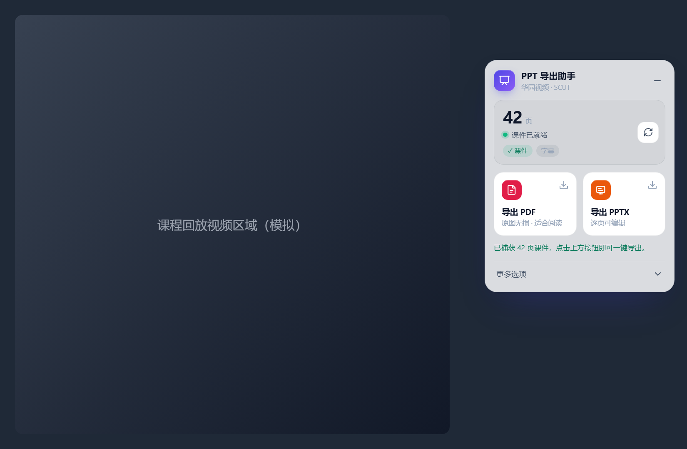
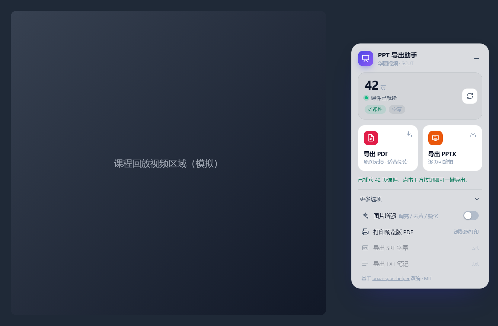

# 华园视频（SCUT）PPT 导出助手

适用于华南理工大学课程回放平台「华园视频」（`video.jw.scut.edu.cn` 及校外 WebVPN `video-jw-443.webvpn.scut.edu.cn`）的 **Tampermonkey（篡改猴）** 用户脚本。

在课程回放页（`/livingroom`）自动捕获课程 PPT 图片，一键无损打包导出为 **PDF** 或 **PPTX**，并附带 **SRT 字幕**、**TXT 笔记**导出与可选图像增强功能。

## 界面预览

| 就绪状态 | 展开「更多选项」 |
| :---: | :---: |
|  |  |

## 主要功能

- **校内 / 校外双入口支持**：同时适配校内直连（`video.jw.scut.edu.cn/livingroom*`）与校外 WebVPN（`video-jw-443.webvpn.scut.edu.cn/livingroom*`）。
- **一键导出 PDF**：基于 `pdf-lib` 直接将原始 JPG/PNG 幻灯片无损嵌入 PDF，按原图宽高比排版无白边，并针对平板（如 GoodNotes / Notability）调整了页面尺度。若 CDN 不可用，会自动回退至横版打印预览页另存为 PDF。
- **一键导出 PPTX**：基于 `PptxGenJS` 打包 `.pptx` 文件，自动识别 16:9 / 4:3 画幅并居中适配不拉伸，方便二次删改或补充课堂笔记。
- **主动拉取 + 跨域兼容**：页面加载初期即监听接口，同时提供「主动拉取」按钮兜底；图片下载走油猴 `GM_xmlhttpRequest`，规避浏览器跨域（CORS）限制并显示实时进度条。
- **更多实用能力**：
  - 可选 **图片增强**（调亮 / 去黄 / 锐化）
  - **打印预览版 PDF**（支持浏览器直接打印）
  - 导出 **SRT 字幕** 与 **带时间戳 TXT 笔记**
- **轻量美观 UI**：毛玻璃卡片风格、Shadow DOM 样式隔离（不受原网页 CSS 影响）、支持系统深色模式、可拖动并收起为带页数角标的悬浮小按钮（自动记忆位置与折叠状态）。

## 安装方法

1. 在 Chrome / Edge 浏览器安装 **[Tampermonkey（篡改猴）](https://www.tampermonkey.net/)** 扩展。
   - *注：Edge / Chrome 新版需在扩展管理页开启「开发者模式」或「允许运行用户脚本」。*
2. 安装本脚本（任选其一）：
   - **一键安装（推荐）**：打开仓库里的 [scut-livingroom-ppt-helper.user.js](./scut-livingroom-ppt-helper.user.js)，点击页面右上角的 **Raw** 按钮，Tampermonkey 会自动弹出安装页面，点击「安装」即可。
   - **手动安装**：打开 Tampermonkey →「添加新脚本」→ 清空默认内容 → 复制粘贴 `scut-livingroom-ppt-helper.user.js` 全部代码 → `Ctrl + S` 保存。

## 使用说明

1. 登录华园视频并打开任意课程回放页（URL 形如 `https://video.jw.scut.edu.cn/livingroom?course_id=...&sub_id=...`）。
2. 页面右上角会出现 **「PPT 导出助手」** 悬浮面板：
   - 点一下网页里的 **PPT** 标签，或点面板右侧的 **↻（主动拉取）** 按钮；
   - 看到大号页数显示且圆点变绿（`课件已就绪`）后，直接点击 **「导出 PDF」** 或 **「导出 PPTX」** 即可。
3. 首次导出图片时，如果 Tampermonkey 弹出跨域请求确认窗口，点击 **「始终允许域名」** 即可。

## 常见问题

- **面板一直显示「等待捕获课件」？**
  先点击课程页面自带的「PPT / 课件」标签，或点击悬浮面板中的 **↻** 按钮主动向接口拉取。
- **校外通过 WebVPN 无法导出？**
  请先确保已在浏览器中完成 WebVPN 登录，且当前处于 `video-jw-443.webvpn.scut.edu.cn/livingroom?...` 页面。
- **导出 PPTX 或 PDF 提示库未加载？**
  脚本通过 `cdn.jsdelivr.net` 加载 `pptxgenjs` 和 `pdf-lib`，请检查网络是否可正常访问 jsDelivr；即使无法访问，点击「打印预览版 PDF」仍可离线通过浏览器打印另存为 PDF。

## 致谢与协议

- 本项目基于 MIT 开源项目 **[peter-erer/buaa-spoc-helper](https://github.com/peter-erer/buaa-spoc-helper)**（原作者：`micraow`、`Peter-erer`）针对华南理工大学华园视频平台进行适配与 UI 重构。
- 华园视频接口验证参考了开源项目 **[jbykkk/scut-courses-replay-extraction](https://github.com/jbykkk/scut-courses-replay-extraction)**。
- 依赖开源库：[PptxGenJS](https://github.com/gitbrent/PptxGenJS)、[pdf-lib](https://github.com/Hopding/pdf-lib)。
- 本项目继续采用 **[MIT License](./LICENSE)** 开源。

## 免责声明

本脚本仅供华南理工大学校内师生个人学习与课后复习使用。脚本不会绕过学校统一身份认证或破解视频权限，仅用于整理用户本人已拥有访问权限的课程页面内容。请勿将导出的课件与字幕用于商业用途或未经授课教师许可的公开传播。
